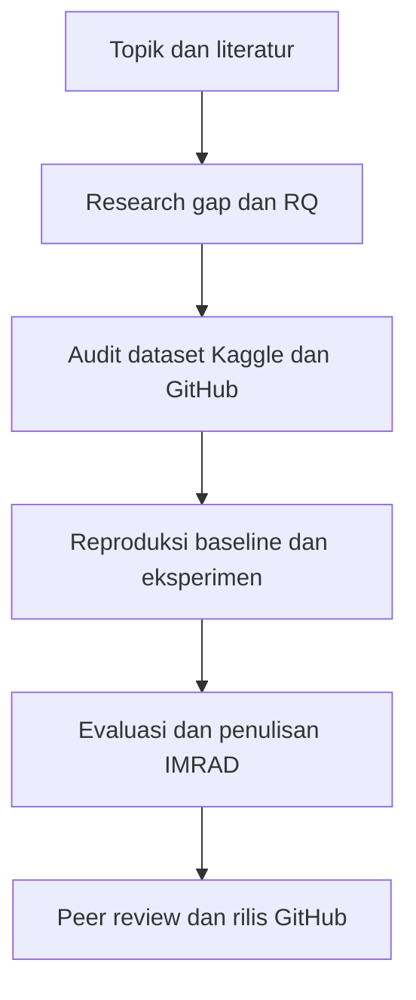

# Cost-Aware Software Defect Prediction (TTKI – Topik P3)

Proyek Tata Tulis Karya Ilmiah, Sarjana Terapan Teknik Informatika PENS, 2026.
Anggota Kelompok : 
[Ashlihatul Sotya Mahendra – 3124600110], 
[Revalina Salsabila – 3124600120].

## Research question
Pada data NASA MDP dari Kaggle, bagaimana *class weighting* dan strategi
pemeringkatan modul (probabilitas cacat vs probabilitas ÷ LOC) memengaruhi
persentase modul cacat yang ditemukan dalam anggaran inspeksi 20% total LOC,
dibandingkan urutan acak dan ManualUp?

## Status
- [x] Minggu 2 – audit data, environment, baseline (LR, RF, Random, ManualUp)
- [ ] Minggu 3 – Skenario A (class weighting), B2 (probabilitas ÷ LOC)
- [ ] Minggu 4 – paper IMRAD

## Data
NASA Software Defect Prediction, Kaggle (aczy156):
https://www.kaggle.com/datasets/aczy156/nasa-software-defect-prediction
Diunduh 12 November 2026. Cara mengunduh dan lisensi: [`data/README.md`](data/README.md).
CSV **tidak** di-commit.

## Environment
- Diuji dengan **Python 3.9.6 pada macOS** (Apple Silicon);
  numpy 2.0.2, pandas 2.3.3, scikit-learn 1.6.1.
  Versi paket lengkap ada di `environment-freeze.txt`.

```bash
python3 -m venv .venv
source .venv/bin/activate          # Windows: .venv\Scripts\activate
pip install -r requirements.txt
python -m src.run_baseline
```
Waktu run baseline (4 proyek × 10 seed): ± [1] menit.

## Cara menjalankan (urutan)
1. Unduh data ke `data/raw/` (lihat `data/README.md`).
2. `notebooks/01_eda.ipynb` – audit file, kolom, duplikat, rasio kelas.
3. `notebooks/02_baseline.ipynb` – atau langsung: `python -m src.run_baseline`
4. `notebooks/03_experiment.ipynb` – skenario Minggu 3.

## Protokol (dibekukan sebelum melihat hasil test)
| Item | Keputusan |
|---|---|
| Unit observasi | satu modul |
| Pembersihan | hapus nilai kosong/inf, baris identik, dan semua baris inkonsisten (fitur sama, label beda) **sebelum split** |
| Split | stratified train/validation/test 60/20/20 |
| Seed | 0–9 (10 ulangan) |
| Transformasi | log(1+x) + StandardScaler dalam `Pipeline`, di-fit pada train saja |
| Baseline model | Logistic Regression, Random Forest (300 pohon), tanpa class weighting |
| Baseline urutan | Random, ManualUp (LOC terkecil dulu) |
| Metrik klasifikasi | precision, recall, F1 (threshold 0,5), PR-AUC, ROC-AUC |
| Metrik anggaran | Recall@20% LOC, precision@20% LOC, % modul dibuka, IFA, Popt |
| Definisi "ditemukan" | jumlah **modul** cacat yang terinspeksi (NASA hanya punya label biner) |

## Output
| File | Isi |
|---|---|
| `results/audit.csv` | audit data mentah per proyek |
| `results/cleaning.csv` | jumlah baris sebelum/sesudah pembersihan |
| `results/metrics.csv` | metrik per proyek × model × seed × set |
| `results/run_log.txt` | versi Python/paket, seed, ringkasan hasil test |

## Alur kerja


## Atribusi
- Struktur awal terinspirasi dari https://github.com/SonamKumari1227/-Software-Defect-Prediction .
  Perbedaan: data diunduh dari Kaggle (salinan Kaggle juga berupa versi D''),
  SMOTE tidak dipakai, dan ditambah metrik anggaran inspeksi 20% LOC.
- Pembersihan data mengikuti Shepperd et al. (2013), doi:10.1109/TSE.2013.11.
- Baseline ManualUp mengikuti Zhou et al. (2018), doi:10.1145/3183339.
- Matriks literatur: `references/literature_matrix.csv`.

## Penggunaan AI
Kerangka kode dan dokumentasi awal disusun dengan bantuan Claude (Anthropic);
seluruh kode telah dijalankan dan diperiksa oleh kelompok. 

## Lisensi
Kode: MIT (`LICENSE`). Dataset mengikuti lisensi di halaman Kaggle.
